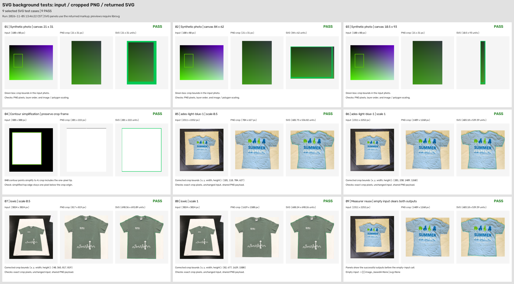
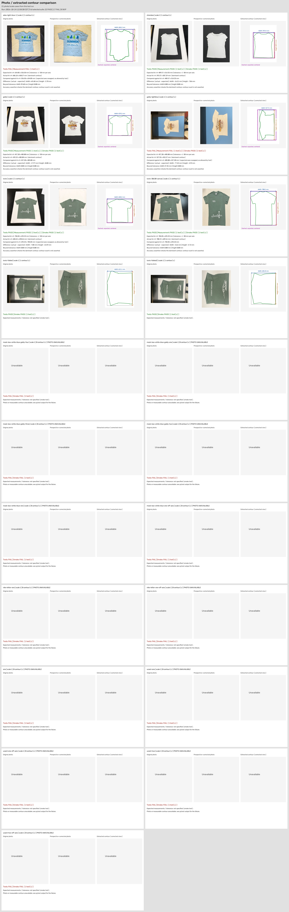

```bash
pip install --upgrade --force-reinstall --no-cache-dir .
```

## SVG with a cropped photo background

After a successful measurement, `measurer.image_base64` and
`debug["object_image_base64"]` contain the same base64-encoded PNG (without a data
URI prefix). The photo is perspective-corrected and cropped to the dominant
contour's axis-aligned bounding box, including its last pixel row and column.
The crop retains the photo background within that rectangle.

`measurer.svg` (also `debug["object_contour_svg"]`) is a complete SVG containing an
`<image href="data:image/png;base64,...">` followed by the contour polygon. The
image fills the SVG canvas beneath the outline. Both use the same crop
coordinates and canvas scaling, including when the polygon is simplified.
The photo and SVG properties are `None` before measurement or if no object is
found.

```python
import base64
from pathlib import Path

import cv2
from ReferenceSurfaceMeasurer import ReferenceSurfaceMeasurer

measurer = ReferenceSurfaceMeasurer(reference_size_mm=(762, 762))
measurements, debug = measurer.measure(cv2.imread("garment.jpg"), return_debug=True)
if debug["status"] == "ok":
    Path("garment.png").write_bytes(base64.b64decode(measurer.image_base64))
    Path("garment.svg").write_text(measurer.svg, encoding="utf-8")
```

The SVG background tests produce one image showing the input, decoded PNG crop,
and rendered SVG for all nine cases, including their test results:



Regenerate it with `python -m pytest tests/test_svg_background.py`. Rendering the
SVG previews requires `rsvg-convert` from librsvg. Each card also shows its image
dimensions and the checks performed, including the empty-input reset case.

## Photo and contour comparison

Each case shows the original photo, the perspective-corrected photo, and the
extracted contour side by side.
The contour panel includes the measurement box, with blue width and orange
height arrows and values in millimeters.
Each card shows the latest test outcome, expected measurements, tolerance, and
measurement errors. The header records the run time and selected suite totals.
A dashed magenta box shows the expected size, centered on the measured box and
drawn at the same scale when expected dimensions are available.

Perspective correction preserves the input photo's orientation. The reference
dimensions are matched to the visible horizontal and vertical edges, so either
portrait or landscape photos can use the same reference size. Measurement axes
follow the corrected photo. Inputs are decoded image arrays; any camera rotation
metadata must be applied when loading the photo.

Foreground segmentation estimates background color and its variation from the
reference border. Lab channels with a wide background range receive less weight,
so uneven illumination on the canvas does not add bright or shaded patches to a
pale shirt's contour. The debug trace records the background range and channel
weights alongside the segmentation threshold.



Regenerate this asset with the full test suite:

```bash
OBJECT_MEASURER_SAVE_DEBUG_IMAGES=false python -m pytest
```

The image is saved to `assets/contour-comparison.jpg`. Running a subset of the
photo tests replaces it with only the selected cases; run the full suite before
checking in the asset.
